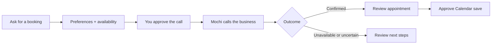
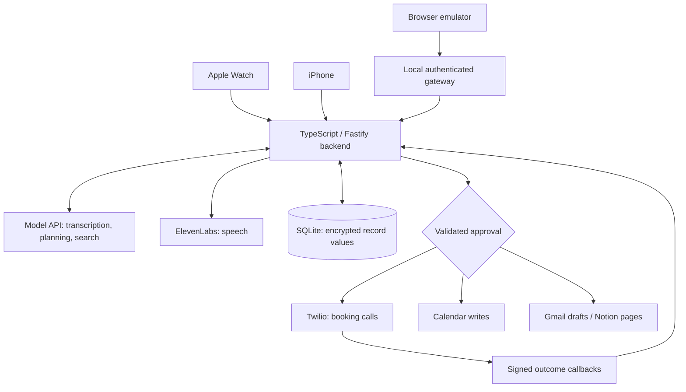

# Mochi for Watch

[](https://github.com/vbshuliar/mochi-for-watch/actions/workflows/checks.yml)
[](LICENSE)


[Website](https://mochi-for-watch.fly.dev/) · [Quick start](#run-it-locally) · [Architecture](#inside-the-app) · [Documentation](docs/README.md) · [Agent setup](docs/agent-setup.md)


## Ask for a haircut. Let Mochi make the call.

Mochi is a personal assistant for Apple Watch. Tell him what you need, review the proposed call, and let him speak with the business to arrange it.

> “Book my usual haircut next week. Any afternoon except Thursday.”

Mochi uses your saved preferences and Calendar availability to prepare the request. After you approve, he handles the phone conversation while you keep chatting or check progress from your Watch or iPhone.

**You approve the call. Mochi negotiates within your instructions. You review the outcome.** Adding the appointment to Calendar gets a separate approval.

**Private, self-hosted, single-owner.** Includes native Watch/iPhone apps and a browser emulator. The illustration shows the intended interface; live booking and latest physical-device acceptance remain pending.

<br clear="both" />

## How booking works



| Step | What happens |
| --- | --- |
| **Prepare** | Mochi checks saved business details, service, preferred hours and Calendar availability. Missing details are requested before dialing. |
| **Approve** | You review the recipient, purpose and allowed times. Live calls also require a configured destination allowlist. |
| **Call** | Mochi identifies himself as your AI assistant, asks for consent and negotiates within the approved window. The task continues in the background. |
| **Review** | Shared Watch/iPhone tasks show progress and the recorded result. A call ending does not count as a confirmed appointment. |
| **Follow through** | Review a Calendar save, a retry proposal, or a change to a linked booking. An uncertain result is preserved for reconciliation rather than blindly retried. |

[Booking setup and safeguards](docs/booking-calls.md) · [Usual haircut preferences](docs/booking-experience.md)

## What else you can do

| Capability | Use it for | Boundary |
| --- | --- | --- |
| **Voice and memory** | Interruptible conversations; preferences you can view, edit and delete on iPhone. | Live speech needs provider credentials. |
| **Web search** | Current answers with source links. | Uses the configured search/model provider. |
| **Calendar** | Availability, new events, and reviewed changes to linked bookings. | Writes need approval. |
| **Daily briefing** | Booking progress, today's events, due reminders and recent inbox context. | On demand; not an automatic morning message. |
| **Reminders** | Persistent, shared reminders with snooze and recurrence. | Stored in Mochi, not Apple Reminders; push needs APNs setup. |
| **Gmail drafts** | Review a recipient, subject and message, then save an unsent draft. | Separate compose permission; no send endpoint. |
| **Gmail → Notion** | Turn selected email context or your ideas into a document. | Review before saving to an authorized page. |
| **Social activity** | Summaries and reply suggestions for Facebook Pages and linked professional Instagram accounts. | No automatic publishing; personal accounts are not supported. |

[Connection setup](docs/integrations-and-models.md) · [Briefings, reminders and drafts](docs/daily-support.md) · [Gmail and Notion](docs/gmail-notion.md)

## Status and limits

| Area | Current status |
| --- | --- |
| Backend, browser and native logic | Implemented with automated fixture-based checks. See the CI badge for the latest run. |
| End-to-end haircut booking | Complete live acceptance remains pending. Automated tests do not prove a real appointment. |
| Native apps | iPhone/Watch builds are available from source; latest physical-device acceptance remains pending. |
| Completion and reminder alerts | Implemented; require Apple push provisioning and device verification. |
| Distribution | Private single-owner deployment; not an App Store release or shared multi-user service. |
| Outside scope | Phone-menu navigation, payments/deposits, and automatically trying multiple businesses. |

The haircut demo focuses on calling and Calendar. Gmail and Notion are optional integrations outside that demo. See the [acceptance checklist](docs/development-acceptance.md).

## Run it locally

**Requirements:** Node.js 24, npm and a browser. No Watch or provider credentials are needed for the mock backend demo. Native apps require macOS/Xcode, iOS 17+ and watchOS 10+.

### 1. Start the backend

```sh
git clone https://github.com/vbshuliar/mochi-for-watch.git
cd mochi-for-watch/backend
npm ci
npm run setup
npm run build
npm start
```

Setup creates an ignored `.env` with authentication and encryption keys. Existing configuration is preserved. Keep the encryption key when retaining the database.

### 2. Open the browser emulator

In another terminal, from `backend/`:

```sh
npm run emulator
```

Open **[127.0.0.1:4174/preview/emulator/](http://127.0.0.1:4174/preview/emulator/)**. With the backend running, `npm run demo` exercises proposal → approval → receipt without calling external services.

Mock mode uses deterministic fixtures; it does not provide arbitrary spoken conversation.

### 3. Enable live services

Edit `backend/.env` locally, then restart the backend:

```dotenv
APP_MODE=live
DATABASE_PATH=./data/live.sqlite
MODEL_API_KEY=your-model-api-key
ELEVENLABS_API_KEY=your-elevenlabs-api-key
```

Use separate live and mock databases. Credentials stay on the server. In the emulator, tap Mochi, allow microphone access and speak; pause or tap again to finish, and tap during a reply to interrupt.

| Connect | Required setup |
| --- | --- |
| Model and speech | Provider accounts, credentials and credits. [Configuration](docs/configuration.md) · [Environment template](backend/.env.example) |
| Google Calendar | Google OAuth web client and Calendar grant. [Provider setup](backend/README.md#connect-live-providers) |
| Telephone calls | Twilio, HTTPS callbacks and a consenting destination allowlist. [Calling guide](docs/booking-calls.md) |
| Watch and iPhone | Build the native apps, pair using a one-time code, then sync the Watch. [Installation](native/README.md) |
| Optional integrations | Separate Gmail/Notion grants or eligible social accounts. [Connections](docs/integrations-and-models.md) |

## Inside the app



| Component | Responsibility | Source |
| --- | --- | --- |
| SwiftUI clients | Voice interaction, shared tasks, action review and pairing. | [native/](native/) |
| Browser emulator | Explore the same flows without installing on a device. | [preview/emulator/](preview/emulator/) |
| Backend | Provider credentials, validated plans, approvals and durable task state. | [backend/src/](backend/src/) |
| Character renderer | Blinking, gaze, speech reactions and reduced motion. | [Animation playground](preview/animation/README.md) |
| Hosting | HTTPS backend with one writable SQLite volume; separate static website. | [Operations guide](docs/private-deployment.md) |

A model response cannot directly dial or write an event. The backend validates proposals and requires approval. Duplicate decisions and ambiguous provider outcomes have recovery paths. With a hosted backend, your Mac can stay off; internet access is required.

[Architecture](docs/architecture.md) · [Code map](docs/code-map.md) · [API and provider configuration](backend/README.md)

## Your data and controls

| Area | Behavior |
| --- | --- |
| **Device access** | Expiring one-time pairing codes and revocable device tokens. Each deployment serves one owner. |
| **Stored data** | Credentials, histories and action record values use AES-256-GCM. Identifiers remain database metadata; this is not whole-disk encryption. |
| **Memory** | Saved facts can be edited or deleted. Deleting a conversation does not erase shared memories or undo external actions. |
| **Audio** | Microphone audio is not stored by the app. Calls are not recorded. Generated telephone reply clips are encrypted, served through short-lived links and pruned. |
| **External providers** | Relevant audio and text are sent to connected providers; their retention policies apply separately. |
| **Disconnection** | Blocks new operations and removes local credentials; previously created external data remains. |

[Memory controls](docs/memory.md) · [Call safeguards](docs/booking-calls.md) · [Backup and recovery](docs/operations-readiness.md)

## Development and checks

From the repository root:

```sh
npm --prefix backend run format
npm --prefix backend run check:all

# For native UI / SDK changes, on macOS with Xcode:
sh native/scripts/check.sh
```

| Check | Coverage |
| --- | --- |
| Backend | Formatting, types, build, authentication, provider contracts, approval and recovery behavior. |
| Browser | Microphone lifecycle, interruptions, streamed playback, tasks and action review. |
| Animation | Scripted checks across 26 character states. |
| Native | Shared model and conversation tests in CI; SDK builds through the local Xcode check. |

CI uses synthetic providers and does not place calls, save appointments or establish physical-device acceptance.

[Agent setup](docs/agent-setup.md) · [Contributing](CONTRIBUTING.md) · [Release runbook](docs/runbook.md) · [Troubleshooting](docs/troubleshooting.md)

## License and support

Original project code and artwork are available under [Apache-2.0](LICENSE), to the extent applicable rights are held. Hosted models and services require separate accounts and terms. Apple Watch is a compatibility reference; provider names do not imply endorsement.

[Security](SECURITY.md) · [Support](SUPPORT.md) · [Third-party notices](THIRD_PARTY_NOTICES.md) · [Artwork provenance](docs/design/mochi.md)
