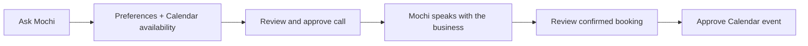
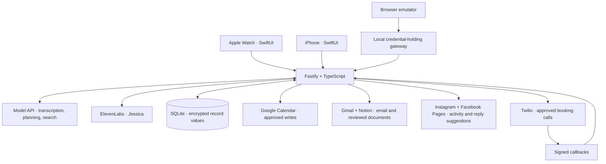

# Mochi for Watch

<div align="center">

**MOCHI · YOUR PERSONAL SECRETARY, ON YOUR WRIST**

[](https://github.com/vbshuliar/mochi-for-watch/actions/workflows/checks.yml)


[Website](https://mochi-for-watch.fly.dev/) · [Quick start](#run-it-locally) · [Agent setup](docs/agent-setup.md) · [Documentation](docs/README.md) · [Contributing](CONTRIBUTING.md)

</div>


### Your personal secretary, on your wrist.

**Mochi makes calls on your behalf and handles tasks across your connected services.**


**Ask once. Let Mochi take care of the conversation.**

[Meet Mochi](#meet-mochi) · [The booking flow](#one-request-a-whole-task) · [Run locally](#run-it-locally) · [Architecture](#inside-the-app) · [Docs](#find-your-way-around)

<br clear="both" />

---

## Meet Mochi

Need a haircut booked, a free afternoon found, or your travel emails turned into a plan? Tell Mochi from your Apple Watch.

**Mochi is your personal secretary with a face you’ll love talking to.** He remembers your preferences, uses the services you connect, and carries out tasks on your behalf. For a booking, he checks your Calendar, calls the business, speaks as your AI assistant, and negotiates within the times you approved.

**You approve the call. Mochi handles the conversation.** Keep chatting while he works in the background, swipe to check progress, and review the result when he’s finished. Saving the appointment to Calendar gets its own approval.

Connect Calendar, Gmail, Notion, Instagram and Facebook Pages to give Mochi useful context and capabilities. Ask him to summarize email, prepare a Notion document, or catch you up on social activity. One familiar companion brings the connected tools together.

He still blinks, glances around, reacts to your words and sends little hearts when you compliment him. The personality makes delegation feel like a conversation.

<table>
<tr>
<td width="50%" valign="top">

### Small screen, plenty of personality

- A plush face and one readable status line.
- Head movement responds to microphone volume.
- Thoughtful glances, expressive replies and a single burst of hearts.
- Smooth transitions from listening to thinking to speaking.
- Interruptible voice replies and streaming transcription.

</td>
<td width="50%" valign="top">

### Delegate the follow-through

- Call businesses and speak on your behalf after approval.
- Negotiate appointments around your Calendar and preferences.
- Summarize email and draft Notion documents.
- Read connected social activity and suggest replies.
- Remember preferences you can edit or delete on iPhone.
- Keep chatting while an approved booking runs.
- Check real call progress and review an idle-time result card.
- Ask before calling or saving an event.

</td>
</tr>
</table>

[Explore the character playground](preview/animation/README.md) · [Artwork and animation guide](docs/design/mochi.md)

## A look at Mochi

<table>
<tr>
<td align="center" width="50%"><br/><strong>The new Mochi companion</strong><br/><sub>Generated portrait · selected 29 October 2026</sub></td>
<td align="center" width="50%"><strong>Ask → approve → call → review</strong><br/><sub>Autonomous booking within your approved instructions. Calendar writes receive separate approval.</sub></td>
</tr>
</table>

[Native capture provenance](native/Verification/README.md) · [Character playground](preview/animation/README.md) · [Visual asset notices](THIRD_PARTY_NOTICES.md)

## One request. A whole task.

The signature workflow: delegate a booking from your wrist, and let Mochi handle the phone conversation autonomously within your approved instructions.

> **You:** “Call my usual barber. Any afternoon next week, except Thursday.”

Mochi uses saved details where available, asks about anything missing, and checks the requested windows against your Calendar. You review the number, purpose and allowed times before the call starts.

> **Mochi, on the call:** “Hi, I’m Mochi, Alex’s AI assistant. Is this Demo Salon? I’m calling to arrange a haircut. Is it okay to chat?”
>
> **Then:** “Do you have anything between 2 and 4 pm on Friday?”

Once the call starts, Mochi stays available for another conversation. Ask how the booking is going to hear its recorded status. A completion card waits until you finish speaking; reopening the app refreshes the task. Swipe to the tasks page for in-progress work, items needing your approval and recent completions.

He offers natural ranges, not a list of fifteen-minute slots. When the business suggests an allowed time, he moves to confirmation. A verified booking becomes a result you can review and separately approve for Calendar.



## What Mochi can do

| Capability | Experience |
| --- | --- |
| **Voice conversation** | Speak naturally, interrupt a reply, and hear Mochi answer through the configured model and speech services. |
| **Expressive face** | Blinking, thoughtful glances, playful reactions and smooth speech animation. |
| **Personal memory** | Remember preferences across conversations, with iPhone controls to view, edit and delete facts. |
| **Current answers** | Search the web through the configured provider and follow source links. |
| **Google Calendar** | Check events and availability, then review and approve new appointments. |
| **Booking calls** | Let Mochi call on your behalf, negotiate within your preferred times, and report the result while you keep chatting. |
| **Daily support** | Booking-first daily briefing, persistent reminders, and reviewed unsent Gmail drafts. |
| **Usual booking setup** | Save your barber, service and preferred hours; review booking follow-through and safe retry proposals. |
| **Gmail → Notion** | Summarize matching emails or turn ideas into Notion pages, with review before saving. |
| **Instagram / Facebook Pages** | Read recent activity from a selected account and get suggested replies. Nothing is published automatically. |

Connected services use their own account permissions. Calendar supports availability, new single events, and reviewed changes to Mochi's linked booking events; Gmail is read-only by default, with optional reviewed unsent drafts; social connections support managed Pages and linked professional Instagram accounts. See [connection capabilities and setup](docs/integrations-and-models.md).

The latest development build adds a structured usual-booking profile, safe retry proposals, booking reminders, readiness checks, one-time private pairing, and shared Watch/iPhone booking tasks, reviewed rescheduling and cancellation, separately approved Calendar updates/removals, and opt-in completion alerts. Alerts require Apple push provisioning. Live booking-change tests and physical-device acceptance remain pending; see [the acceptance checklist](docs/development-acceptance.md) and [notification setup](docs/task-notifications.md).

## Readiness, honestly

The booking flow, approval controls, recovery paths and native clients are implemented. Automated checks use fixtures; they do not prove a real telephone appointment. The current owner deployment has Calendar, Gmail and Notion connected. Live haircut acceptance, latest physical-device acceptance and Apple push provisioning remain outstanding. Gmail and Notion stay outside the signature haircut demo.

This is a private single-owner prototype, not an App Store release or multi-user service. Phone-menu navigation, payments/deposits and automatically trying multiple businesses are outside the implemented scope. Original project code and artwork are available under [Apache-2.0](LICENSE). Hosted services require their own accounts and terms.

## Run it locally

Before committing or pushing development changes, run `npm --prefix backend run format` followed by `npm --prefix backend run check:all` from the repository root. This runs the checks shared with GitHub CI. Native UI changes additionally require `sh native/scripts/check.sh` for SDK builds.

**You need:** Node.js 24, npm and a browser. No Watch is required to explore the emulator. Live voice needs model and speech-provider credentials; mock mode uses deterministic fixtures.

### 1 · Start the backend

```sh
git clone https://github.com/vbshuliar/mochi-for-watch.git
cd mochi-for-watch/backend
npm ci
npm run setup
npm run build
npm start
```

Setup creates a private, ignored `.env` and generates authentication/encryption keys. It leaves existing configuration intact. Keep the encryption key when retaining the database.

### 2 · Open the emulator

In a second terminal, from `backend/`:

```sh
npm run emulator
```

Open **[127.0.0.1:4174/preview/emulator/](http://127.0.0.1:4174/preview/emulator/)**. The Watch preview sits above the iPhone companion; the activity log explains requests and results, with payloads collapsed until clicked.

Mock mode is for deterministic backend examples, not arbitrary spoken conversation. With the backend running, `npm run demo` exercises proposal → approval → receipt without calling external providers.

### 3 · Give Mochi a real voice

Edit `backend/.env` locally:

```dotenv
APP_MODE=live
DATABASE_PATH=./data/live.sqlite
MODEL_API_KEY=your-model-api-key
ELEVENLABS_API_KEY=your-elevenlabs-api-key
```

Restart the backend, tap Mochi and allow microphone access. Speak, then pause—or tap again to finish. Use separate live/mock databases. Credentials belong on the server, never in browser code or Git.

<details>
<summary><strong>Provider defaults and optional connections</strong></summary>

| Setting | Default / role |
| --- | --- |
| `ELEVENLABS_VOICE_ID` | `cgSgspJ2msm6clMCkdW9` — Jessica |
| `ELEVENLABS_MODEL` | `eleven_flash_v2_5` |
| `API_TOKEN` / `ENCRYPTION_KEY` | Generated locally by setup |

Provider access and credits are required. The [environment template](backend/.env.example) lists credentials; [configuration defaults](backend/src/config.ts) are authoritative.

- **Calendar:** create a Google OAuth web client, configure credentials, then connect in the companion UI. [Setup](backend/README.md#connect-live-providers).
- **Calls:** configure Twilio, an HTTPS callback origin and a consenting destination allowlist. [Booking guide](docs/booking-calls.md).
- **Hosted emulator:** set `EMULATOR_BACKEND_URL` to your HTTPS backend. The gateway keeps the app token server-side. [Emulator guide](preview/emulator/README.md).
- **Gmail / Notion:** separate account grants and reviewed document creation. [Setup and limits](docs/gmail-notion.md).
- **Instagram / Facebook Pages:** connect and select an eligible account, read recent activity, and ask Mochi for summaries or reply suggestions. Nothing is published. [Setup and limits](docs/social-connections.md).

</details>

## Inside the app



The backend owns provider credentials, validated plans and action state. A model response cannot directly dial a phone or write an event: those actions pass through explicit approval endpoints. Callbacks are authenticated, duplicate decisions are handled, and ambiguous outcomes are preserved for recovery rather than blindly retried.

The backend runs on **Fly.io with persistent storage**. The configured model service supplies reasoning, ElevenLabs the voice, and Twilio telephone calls. The Watch connects over HTTPS, so your Mac can stay off. Internet access is required.

Private pairing uses expiring one-time codes and revocable device tokens. [Readiness, backup and recovery](docs/operations-readiness.md) describe the private release controls.

Read the [architecture](docs/architecture.md), [Fly operations guide](docs/private-deployment.md), or [native installation guide](native/README.md).

## Built to be inspectable

| Layer | Checks |
| --- | --- |
| Backend | TypeScript build, formatting, authentication, provider contracts, approvals, memory, Calendar and call recovery tests |
| Browser | Microphone lifecycle, interruptions, streamed playback, reactions, call review and recovery |
| Character | Scripted 26-state animation check |
| Native | Shared model and conversation tests; local iPhone/Watch SDK builds |

```sh
# From backend/
npm test
npm run typecheck
npm run build
npm run format:check

# From the repository root
node --test preview/emulator/*.test.mjs
node preview/animation/check.cjs
sh native/scripts/check.sh  # macOS + Xcode
```

[GitHub Actions](.github/workflows/checks.yml) runs backend, browser, animation and native host tests without provider credentials. Native device/simulator builds remain a local Xcode check. Detailed results live in the verification documentation.

## Your data, your decisions

- **Single-owner hosting:** each deployment serves one owner, with one server process and one writable database.
- **Memory you control:** saved facts can be edited or deleted. Removing a session does not automatically remove shared memories or undo external actions.
- **Encrypted record values:** credentials, histories and action records use AES-256-GCM. Record identifiers remain database metadata; this is not whole-disk encryption.
- **Audio:** microphone audio is not stored by the app. Generated telephone reply clips are stored encrypted and served through short-lived opaque links; clips expire for access after six minutes and are pruned on later synthesis or restart. Calls are not recorded by this implementation.
- **Provider processing:** audio/text goes to the relevant providers. Their retention policies are separate from local storage.
- **Approval first:** calls, Calendar writes and Notion saves require review. Disabling a connection blocks new operations; disconnecting removes local credentials, not previously created external data.

[Backend boundaries](backend/README.md) · [Memory controls](docs/memory.md) · [Call safeguards](docs/booking-calls.md)

## Build with confidence

[Agent setup](docs/agent-setup.md) · [Configuration](docs/configuration.md) · [Code map](docs/code-map.md) · [Release runbook](docs/runbook.md) · [Troubleshooting](docs/troubleshooting.md)

[Contributing](CONTRIBUTING.md) · [Security](SECURITY.md) · [Support](SUPPORT.md) · [Apache-2.0 license](LICENSE) · [Third-party notices](THIRD_PARTY_NOTICES.md)

## Find your way around

```text
backend/src/       API, planning, provider adapters, action state and storage
backend/test/      Behaviour and mocked-provider regression tests
preview/animation/ Mochi renderer and emotion playground
preview/emulator/  Voice emulator, companion UI and activity log
native/            iPhone + Watch apps, shared Swift code and tests
docs/              Product decisions, setup, research and verification
```

| Start with… | Then explore… |
| --- | --- |
| Product idea | [Experience design](docs/experience-design.md) · Roadmap |
| [Booking calls](docs/booking-calls.md) | [Memory](docs/memory.md) · [Web search](docs/web-search.md) |
| [Backend setup](backend/README.md) | [Architecture](docs/architecture.md) · [Deployment](docs/private-deployment.md) |
| [Native apps](native/README.md) | [SwiftUI layout contract](docs/design/swiftui-companion-spec.md) |
| [Full knowledge base](docs/README.md) | Design decisions, research and source records |

---

<div align="center">

**One Mochi. Your preferences. A little less to do.**

Independent open-source project. Apple Watch is a compatibility reference; provider names do not imply endorsement.

</div>
