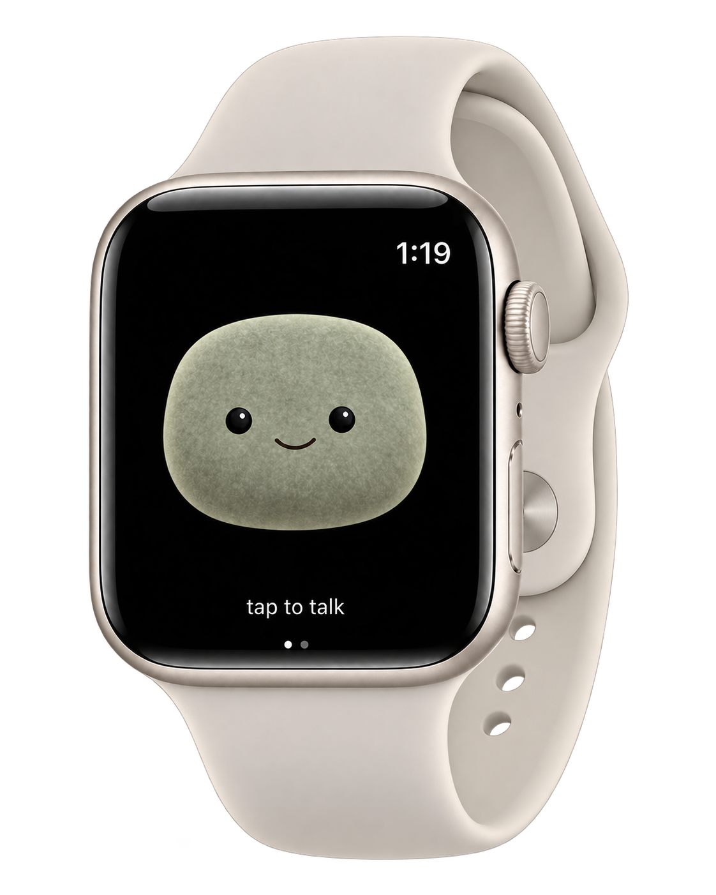
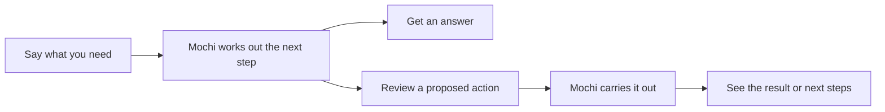
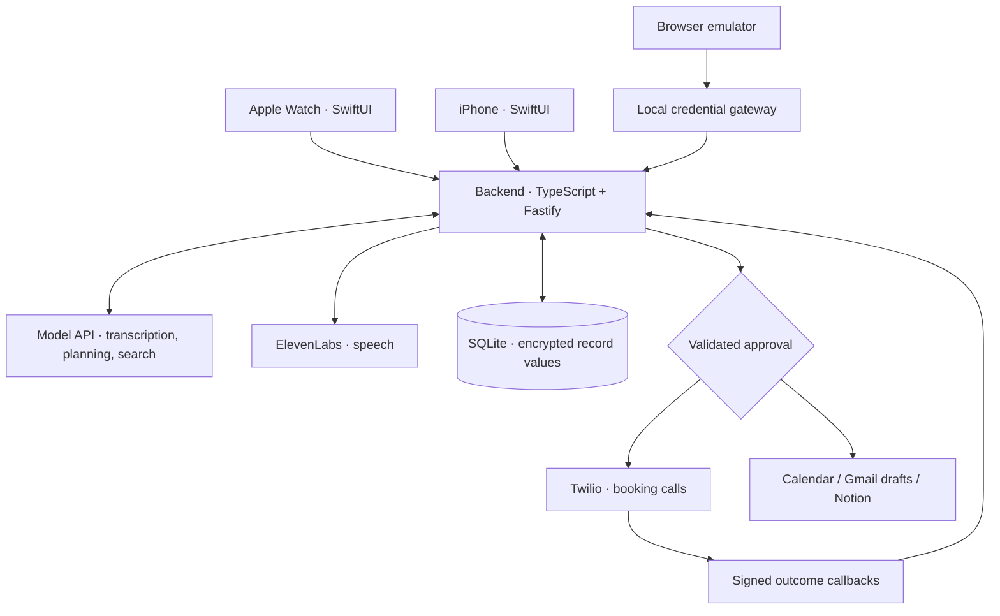

# Mochi for Watch

**Your AI secretary. On the Apple Watch you already own.**

Ask a question. Hand off a task. Get back to your day.

[Explore Mochi](https://mochi-for-watch.fly.dev/) · [What you can do](#a-little-help-throughout-your-day) · [How it works](#from-can-you-to-taken-care-of) · [Try it](#try-mochi)

<p align="center">
  
</p>

Mochi is an autonomous AI companion for everyday life: a quick answer when you’re curious, a memory when something matters, and a secretary to take care of an approved task. From a simple explanation to a phone call on your behalf, the idea is simple: **spend less of your day managing your day.**

Tap Mochi, say what you need, and carry on. He remembers the preferences you choose to share, works with your connected services, and keeps you in control of actions that matter.

## Your next AI device may already be on your wrist

AI is finding new homes: pendants, wristbands, glasses and pocket companions. [Bee](https://bee.computer/), [Omi](https://www.omi.me/) and [Muse Charm](https://about.fb.com/news/2026/09/the-biggest-news-from-connect-2026/) are examples of this move toward dedicated AI hardware.

For someone who already wears an Apple Watch, there is another starting point: a microphone, a screen and a familiar device already close at hand. **Mochi turns that familiar place into a place to ask for help.** No additional wearable to buy or carry.

The opportunity is everyday convenience: catch a thought before it disappears, get an answer without falling into your phone, or hand off the small task you've been putting off. Mochi combines that access with memory, a friendly face and follow-through.

## A little help throughout your day

| When you need… | Say something like… | Mochi helps by… |
| --- | --- | --- |
| **A quick answer** | “Explain that in plain English.” | Talking it through, with web search and source links when current information is needed. |
| **A clearer morning** | “What does my day look like?” | Bringing together your Calendar, booking progress, reminders and recent inbox context. |
| **One less thing to remember** | “Remind me to pick up the parcel at six.” | Saving a reminder you can complete, snooze or repeat. |
| **Help with the admin** | “Draft an email about moving our meeting.” | Helping prepare a message for you to review and save as an unsent Gmail draft. |
| **Someone to make the call** | “Book my usual haircut next week.” | Preparing the details, then calling and negotiating within the instructions you approve. |
| **Continuity** | “Remember that I prefer afternoon appointments.” | Keeping a preference you can inspect, change or delete. |

Connected accounts and permissions determine what's available. You can also turn ideas or selected emails into reviewed Notion pages, and ask for summaries or reply suggestions for supported social accounts. [Explore the capabilities](docs/integrations-and-models.md).

## A familiar face, ready when you need a hand

Mochi blinks, looks around and reacts as you talk. You can interrupt a reply, ask a follow-up or change your mind. The personality gives everyday help a familiar face.

A question can stay a question. A task can keep moving after the conversation ends. Watch and iPhone share task progress, so you can check what happened without starting over.

## From “can you?” to “taken care of”

Autonomy means Mochi can carry out an approved task and bring back the result. You set the intent and boundaries; he handles the steps within them.



### One example: the haircut you've been meaning to book

> “Book my usual haircut next week. Any afternoon except Thursday.”

1. **Mochi prepares.** He uses your saved preferences, checks Calendar availability and asks for anything missing.
2. **You approve.** Review the business, number, service and acceptable times.
3. **Mochi calls.** He introduces himself as your AI assistant, asks for consent and negotiates within your instructions.
4. **You carry on.** The call runs in the background while you keep chatting or check progress later.
5. **Mochi reports back.** Review the outcome and separately approve adding a confirmed appointment to Calendar.

If a booking cannot be confirmed, Mochi reports that instead of presenting an uncertain outcome as success. Booking is one demonstration of the larger promise: **help that follows through.**

[How calling works](docs/booking-calls.md) · [Booking preferences](docs/booking-experience.md)

## Close at hand. Under your control.

| Your choice | What it means |
| --- | --- |
| **When to talk** | Tap to start a conversation. Mochi is not an always-listening recorder. |
| **What to share** | Choose the services you connect and the preferences you save. |
| **What to approve** | Review calls, Calendar changes, Gmail drafts and Notion saves before they happen. Drafts are not sent automatically. |
| **What to remember** | Inspect, edit or delete saved memories from iPhone. |
| **Where it runs** | The open-source app uses your private backend and configured cloud services. Internet access is required. |

Mochi needs an internet connection and a running backend. Connected providers process relevant audio and text under their own terms. [Privacy and data handling](docs/operations-readiness.md) · [Memory controls](docs/memory.md).

## Try Mochi

| Start here | What to expect |
| --- | --- |
| [**Meet Mochi on the website**](https://mochi-for-watch.fly.dev/) | An interactive character preview and setup guidance. |
| [**Explore the browser emulator**](#run-the-browser-demo) | Try the interface and simulated approval flow without owning a Watch or connecting paid services. |
| [**Run it on your Watch**](native/README.md) | Build from source with a Mac and Xcode, set up your backend and pair your iPhone and Watch. |

**Mochi is an open-source prototype.** Native apps and connected workflows are implemented, with automated tests. Complete live haircut booking and latest physical-device acceptance remain pending. It is not yet an App Store download or a shared hosted service. Live providers may charge for usage; push alerts require Apple provisioning.

Today, briefings are requested on demand; reminders live in Mochi rather than Apple Reminders. Phone-menu navigation, payments/deposits and automatically trying multiple businesses are outside scope. [Current acceptance checklist](docs/development-acceptance.md).

## For builders

[](https://github.com/vbshuliar/mochi-for-watch/actions/workflows/checks.yml)
[](LICENSE)

Mochi is built with SwiftUI, TypeScript, Fastify and SQLite, with configured model, speech and calling providers. The source is available to inspect, adapt and run for yourself.

<a id="run-the-browser-demo"></a>
<details>
<summary><strong>Run the browser demo</strong> — no Watch or provider keys required</summary>


Try the mock flow without a Watch, API keys or paid services. You need **Git, Node.js 24 and npm**. Native development additionally requires macOS with Xcode.

### 1. Start the backend

```sh
git clone https://github.com/vbshuliar/mochi-for-watch.git
cd mochi-for-watch/backend
npm ci
npm run setup
npm run build
npm start
```

Leave this terminal running. On a fresh setup, the final startup message is:

```json
{"event":"ready","mode":"mock","host":"127.0.0.1","port":8787}
```

Setup creates a private, ignored `.env` with local authentication and encryption keys. It preserves existing configuration; keep the encryption key when retaining the database.

### 2. Run the example and open the interface

In a second terminal, from the cloned repository's `backend/` directory:

```sh
npm run demo
npm run emulator
```

The demo proposes a **simulated lunch event**, confirms it, then confirms it again to verify that only one event was created. Its output includes:

```text
PROPOSAL ...
CONFIRMED ...
Duplicate confirmation returned the same receipt.
TIMELINE ...
```

Open **[127.0.0.1:4174/preview/emulator/](http://127.0.0.1:4174/preview/emulator/)** to explore the Watch and iPhone interfaces. The activity log shows requests and results.

| Mode | What you can try | What you need |
| --- | --- | --- |
| **Mock** | Deterministic proposals, approvals and receipts; no external writes. | Local setup above. |
| **Live** | Natural voice conversations and the services you connect. | Model/speech credentials; separate grants and configuration for calls, Calendar and other integrations. |

Mock mode does not provide arbitrary spoken conversation. The lunch example validates the approval mechanism; it is not a telephone booking demo.


</details>

<details>
<summary><strong>Connect live services and native apps</strong></summary>


In `backend/.env`, set the following and restart the backend. Replace the placeholder keys with your own credentials:

```dotenv
APP_MODE=live
DATABASE_PATH=./data/live.sqlite
MODEL_API_KEY=your-model-api-key
ELEVENLABS_API_KEY=your-elevenlabs-api-key
```

Keep live and mock databases separate. Provider credentials stay on the server. Provider accounts and usage may incur costs.

| Add | Setup |
| --- | --- |
| **Voice** | Configure the model and ElevenLabs, then allow microphone access in the emulator. [Configuration](docs/configuration.md) |
| **Calendar** | Create a Google OAuth web client and connect Calendar. [Provider setup](backend/README.md#connect-live-providers) |
| **Booking calls** | Configure Twilio, HTTPS callbacks and a consenting destination allowlist. [Calling guide](docs/booking-calls.md) |
| **Watch + iPhone** | Build the native apps, pair with a one-time code and sync the Watch. Requires iOS 17+ / watchOS 10+. [Installation](native/README.md) |
| **Gmail + Notion** | Grant access separately; Gmail draft creation needs the optional compose grant. [Setup](docs/gmail-notion.md) |
| **Social activity** | Connect a managed Facebook Page or linked professional Instagram account. [Setup](docs/social-connections.md) |

[Full environment template](backend/.env.example) · [Push notification setup](docs/task-notifications.md)


</details>

<details>
<summary><strong>Architecture and source map</strong></summary>




The backend owns credentials, action state and approval checks. Model output cannot directly dial a phone or save an event. The hosted backend uses one writable SQLite volume; the public website is a separate static deployment. Your Mac can stay off when using the hosted backend, but internet access is required.

| Explore | Source |
| --- | --- |
| API, providers and durable tasks | [backend/src/](backend/src/) |
| Native clients and shared Swift models | [native/](native/) |
| Browser voice and task interface | [preview/emulator/](preview/emulator/) |
| Character states and animation | [preview/animation/](preview/animation/) |

[Architecture guide](docs/architecture.md) · [Code map](docs/code-map.md) · [Hosting and recovery](docs/operations-readiness.md)


</details>

<details>
<summary><strong>Contributing and validation</strong></summary>


Start with [CONTRIBUTING.md](CONTRIBUTING.md). Coding agents should also read [AGENTS.md](AGENTS.md) and the [agent setup guide](docs/agent-setup.md). Develop against mock providers and preserve approval, consent and recovery behavior.

From the repository root:

```sh
npm --prefix backend run format
npm --prefix backend run check:all

# Native UI / SDK changes, on macOS with Xcode:
sh native/scripts/check.sh
```

The shared checks cover formatting, TypeScript, builds, backend tests, browser behavior, 26 character states and native host tests. CI does not place calls, save real appointments or establish device acceptance. Native SDK builds are a separate local Xcode check.

[Release runbook](docs/runbook.md) · [Changelog](CHANGELOG.md) · [Support](SUPPORT.md)


</details>

[Documentation](docs/README.md) · [Agent setup](docs/agent-setup.md) · [Troubleshooting](docs/troubleshooting.md) · [Report an issue](https://github.com/vbshuliar/mochi-for-watch/issues)

## License


Original project code and artwork are available under [Apache-2.0](LICENSE), to the extent applicable rights are held. Hosted models and services require separate accounts and terms. Apple Watch is a compatibility reference; provider names do not imply endorsement.

[Third-party notices](THIRD_PARTY_NOTICES.md) · [Artwork provenance](docs/design/mochi.md)
