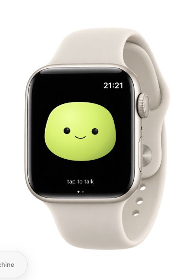

# Mochi for Watch

**Ask your watch to book a haircut. Put your wrist down. Mochi takes the call.**

Mochi is a voice assistant for Apple Watch. Tell it which afternoons work for you. It checks Google Calendar, calls your barber, and adds the appointment when the barber confirms a time. The iPhone companion holds your connections, preferences, and task history.

[Meet Mochi](https://mochi-for-watch.fly.dev/) · [Run the browser demo](#run-the-browser-demo) · [Trace the booking](#trace-the-booking) · [Install on a Watch](native/README.md)

<p align="center">
  
</p>

## One haircut, from wrist to calendar

> **You** · “Book my usual haircut next week. Any afternoon except Thursday.”<br>
> **Mochi** · “Sure, I’ll call right now.” 📞

Once the details are clear, the call continues in the background. Mochi introduces itself as an AI assistant calling on your behalf and asks the barber for an opening in a free window. A typical exchange sounds like this:

> **Barber** · “3 pm works.”<br>
> **Mochi** · “3 pm for Vlad, right?”<br>
> **Barber** · “Yes, that’s correct.”<br>
> **Mochi** · “Thanks, bye bye.”

The booking request authorizes the call and the Calendar save for that exact confirmed slot. Mochi tracks the two outcomes separately, so you can tell whether the barber agreed **and** whether the appointment reached your calendar. Barber availability uses local time and the haircut must finish by 9 pm. [Call workflow](docs/booking-calls.md) · [Booking preferences](docs/booking-experience.md)

## Trace the booking

| Follow this part | Open the implementation | Check the behavior |
| --- | --- | --- |
| Understand the request | [Meta planner](backend/src/meta.ts) turns speech or text into a structured plan. [Service](backend/src/service.ts) interprets it against saved preferences and connected services. | [Booking integration tests](backend/test/booking-integration.test.ts) distinguish saving a preference from asking for a call. |
| Negotiate a time | [Calls](backend/src/calls.ts) filters available slots, checks the destination, handles signed phone callbacks, and recognizes an explicit yes to one offered time. | [Call tests](backend/test/calls.test.ts) exercise the time cutoff, ambiguous answers, and spoken confirmation. |
| Save the result | [Service](backend/src/service.ts) schedules the confirmed Calendar action. The [Calendar adapter](backend/src/calendar.ts) uses a stable event ID so a retry addresses the same event. | In the [call tests](backend/test/calls.test.ts), search for `confirmed new booking automatically saves Calendar once`. The test covers both success and provider failure. |

The released backend uses **Meta Muse Spark** for planning and call dialogue, Meta for transcription, ElevenLabs for speech, and Twilio for telephony. Common greetings and clear replies to a concrete booking offer can take a local shortcut. The hackathon recording used a temporary OpenAI configuration for planning and model-generated call replies, with Meta transcription. [Release configuration](backend/fly.toml) · [Voice and integrations](docs/integrations-and-models.md)

## Run the browser demo

Start from a **fresh clone**, with Node.js 24 and npm. This path creates a local mock backend. You need no Watch, provider keys, or connected accounts.

```sh
git clone https://github.com/vbshuliar/mochi-for-watch.git
cd mochi-for-watch
npm --prefix backend ci
npm --prefix backend run setup
npm --prefix backend run build
npm --prefix backend start
```

Leave the backend running. In a second terminal at the repository root:

```sh
npm --prefix backend run demo
npm --prefix backend run emulator
```

The first command proposes a simulated lunch event and confirms it twice. Look for **“Duplicate confirmation returned the same receipt.”** Then open the [local Watch and iPhone emulator](http://127.0.0.1:4174/preview/emulator/). For the haircut dialogue and Calendar handoff, use the call tests linked above. For a real call, use a separate live database, connected Calendar, and an allowlisted, consenting recipient. [Provider setup](backend/README.md) · [Device pairing](native/README.md)

## When you’re wearing it

Tap once to wake Mochi. While it listens, a tap sends what you’ve said. While it thinks, a tap interrupts and returns to neutral. Mochi can also answer questions, remember preferences you choose to save, and set reminders. The Watch shows task progress while the iPhone lets you manage connections and choose Mochi’s colour. [Memory controls](docs/memory.md) · [Other capabilities](docs/integrations-and-models.md)

## Working in this repo

Start with [AGENTS.md](AGENTS.md) for repository conventions and the [agent setup guide](docs/agent-setup.md) for a read-only review path. The [code map](docs/code-map.md) connects the SwiftUI clients, browser emulator, and TypeScript backend. [Acceptance checklist](docs/development-acceptance.md) distinguishes automated tests from physical-device checks.

From the repository root, with backend dependencies installed and a compatible Swift toolchain:

```sh
npm --prefix backend run check:all
```

This runs formatting checks, TypeScript, backend and browser tests, character animation checks, and native host tests. The public website is a character preview. The backend is designed for one owner. [GitHub Checks](https://github.com/vbshuliar/mochi-for-watch/actions/workflows/checks.yml) · [Release runbook](docs/runbook.md) · [Documentation index](docs/README.md)

Original project code and artwork are available under [Apache-2.0](LICENSE) to the extent applicable rights are held. Hosted services have separate terms. [Third-party notices](THIRD_PARTY_NOTICES.md) · [Artwork provenance](docs/design/mochi.md)
