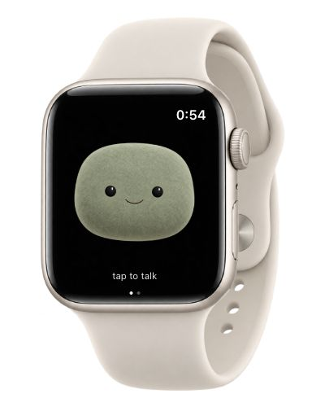
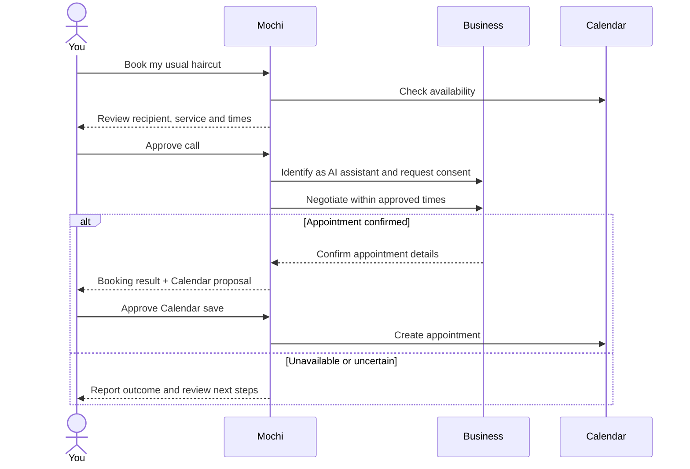
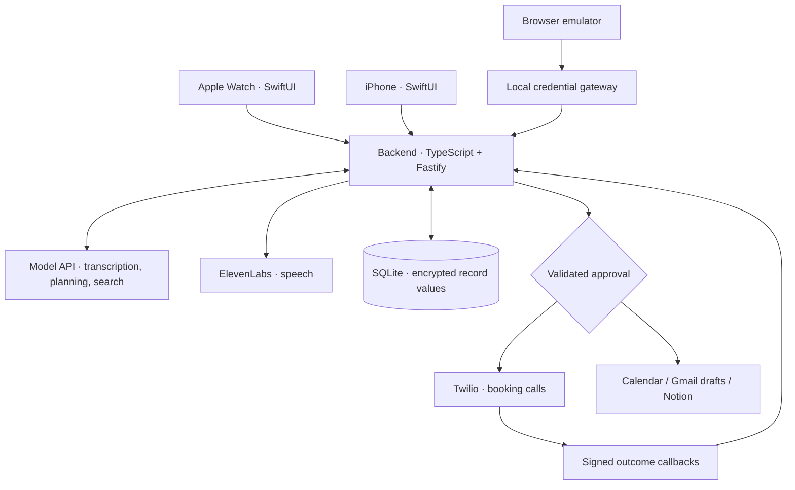

# Mochi for Watch

**An Apple Watch assistant that makes booking calls for you.**

[](https://github.com/vbshuliar/mochi-for-watch/actions/workflows/checks.yml)
[](LICENSE)


[Website](https://mochi-for-watch.fly.dev/) · [Quick start](#quick-start) · [Features](#beyond-booking) · [Architecture](#architecture) · [Documentation](docs/README.md)

<p align="center">
  
</p>

## Ask for a haircut. Let Mochi make the call.

> “Book my usual haircut next week. Any afternoon except Thursday.”

Mochi checks your preferences and Calendar, prepares a booking request, and asks you to approve the call. Then he speaks with the business, negotiates within your instructions and reports the outcome.

- **Keep doing your thing.** The call runs in the background while you keep chatting or check progress from Watch or iPhone.
- **Stay in control.** Review the recipient and allowed times before dialing. Saving the appointment to Calendar gets a separate approval.
- **Pick up where you left off.** Shared tasks retain progress, receipts and uncertain results across conversations.

Built for one owner, with native Watch/iPhone apps, a browser emulator and a self-hosted backend.

> **Prototype status:** automated checks cover the implemented flows; complete live haircut booking and latest physical-device acceptance are still pending. The Watch image is a product illustration. [Status and limits ↓](#status-and-limits)

## Quick start

Try the mock flow without a Watch, API keys or paid services. You need **Git, Node.js 24 and npm**. Native development additionally requires macOS with Xcode.

### 1. Start the backend

```sh
git clone https://github.com/vbshuliar/mochi-for-watch.git
cd mochi-for-watch/backend
npm ci
npm run setup
npm run build
npm start
```

Leave this terminal running. On a fresh setup, the final startup message is:

```json
{"event":"ready","mode":"mock","host":"127.0.0.1","port":8787}
```

Setup creates a private, ignored `.env` with local authentication and encryption keys. It preserves existing configuration; keep the encryption key when retaining the database.

### 2. Run the example and open the interface

In a second terminal, from the cloned repository's `backend/` directory:

```sh
npm run demo
npm run emulator
```

The demo proposes a **simulated lunch event**, confirms it, then confirms it again to verify that only one event was created. Its output includes:

```text
PROPOSAL ...
CONFIRMED ...
Duplicate confirmation returned the same receipt.
TIMELINE ...
```

Open **[127.0.0.1:4174/preview/emulator/](http://127.0.0.1:4174/preview/emulator/)** to explore the Watch and iPhone interfaces. The activity log shows requests and results.

| Mode | What you can try | What you need |
| --- | --- | --- |
| **Mock** | Deterministic proposals, approvals and receipts; no external writes. | Local setup above. |
| **Live** | Natural voice conversations and the services you connect. | Model/speech credentials; separate grants and configuration for calls, Calendar and other integrations. |

Mock mode does not provide arbitrary spoken conversation. The lunch example validates the approval mechanism; it is not a telephone booking demo.

## The booking flow



Mochi asks for missing booking details before dialing. Live destinations must be on the configured allowlist. A call ending is not proof of an appointment, and an uncertain result is retained for reconciliation rather than blindly retried.

[Set up calling](docs/booking-calls.md) · [Save your usual haircut preferences](docs/booking-experience.md) · [Live acceptance checklist](docs/development-acceptance.md)

## Beyond booking

| Ask Mochi to… | What you get |
| --- | --- |
| **Remember your preferences** | Persistent memory with iPhone controls to view, edit and delete facts. |
| **Find current information** | Web-backed answers with source links through the configured provider. |
| **Brief you on today** | Booking progress, Calendar events, due reminders and recent inbox context, on demand. |
| **Remind you later** | Shared reminders with snooze and daily/weekly recurrence; optional push alerts. |
| **Draft an email** | Review the recipient, subject and message, then save an **unsent** Gmail draft. |
| **Turn ideas or email into a document** | Review a Notion page before saving to an authorized destination. |
| **Summarize social activity** | Read selected Facebook Page / linked professional Instagram activity and suggest replies. |

Voice replies are interruptible, and Mochi's face responds with gaze, blinking and speech animation. Reminders live in Mochi, not Apple Reminders. Briefings are on demand; social content is not published automatically.

[All connection capabilities](docs/integrations-and-models.md) · [Briefings, reminders and drafts](docs/daily-support.md)

## Connect live services

In `backend/.env`, set the following and restart the backend. Replace the placeholder keys with your own credentials:

```dotenv
APP_MODE=live
DATABASE_PATH=./data/live.sqlite
MODEL_API_KEY=your-model-api-key
ELEVENLABS_API_KEY=your-elevenlabs-api-key
```

Keep live and mock databases separate. Provider credentials stay on the server. Provider accounts and usage may incur costs.

| Add | Setup |
| --- | --- |
| **Voice** | Configure the model and ElevenLabs, then allow microphone access in the emulator. [Configuration](docs/configuration.md) |
| **Calendar** | Create a Google OAuth web client and connect Calendar. [Provider setup](backend/README.md#connect-live-providers) |
| **Booking calls** | Configure Twilio, HTTPS callbacks and a consenting destination allowlist. [Calling guide](docs/booking-calls.md) |
| **Watch + iPhone** | Build the native apps, pair with a one-time code and sync the Watch. Requires iOS 17+ / watchOS 10+. [Installation](native/README.md) |
| **Gmail + Notion** | Grant access separately; Gmail draft creation needs the optional compose grant. [Setup](docs/gmail-notion.md) |
| **Social activity** | Connect a managed Facebook Page or linked professional Instagram account. [Setup](docs/social-connections.md) |

[Full environment template](backend/.env.example) · [Push notification setup](docs/task-notifications.md)

## Architecture



The backend owns credentials, action state and approval checks. Model output cannot directly dial a phone or save an event. The hosted backend uses one writable SQLite volume; the public website is a separate static deployment. Your Mac can stay off when using the hosted backend, but internet access is required.

| Explore | Source |
| --- | --- |
| API, providers and durable tasks | [backend/src/](backend/src/) |
| Native clients and shared Swift models | [native/](native/) |
| Browser voice and task interface | [preview/emulator/](preview/emulator/) |
| Character states and animation | [preview/animation/](preview/animation/) |

[Architecture guide](docs/architecture.md) · [Code map](docs/code-map.md) · [Hosting and recovery](docs/operations-readiness.md)

## Privacy and control

- **Private pairing:** expiring one-time codes and revocable device tokens. One owner per deployment.
- **Encrypted stored values:** credentials, histories and action records use AES-256-GCM. Record identifiers remain database metadata; this is not whole-disk encryption.
- **Audio handling:** the app does not store microphone audio or record calls. Generated telephone reply clips are encrypted and served through expiring links.
- **Provider processing:** relevant audio and text go to connected providers under their own retention policies.
- **Data deletion:** removing a conversation does not delete shared memories or undo external actions. Disconnecting a service removes local credentials, not documents or events already created there.

[Memory controls](docs/memory.md) · [Call safeguards](docs/booking-calls.md) · [Security policy](SECURITY.md)

## Status and limits

| Available in source | Still requires validation or setup |
| --- | --- |
| Backend, browser and native task flows with automated tests | Complete live haircut booking and booking-change acceptance. |
| Watch/iPhone clients and shared task state | Latest physical-device installation and acceptance. |
| Reminder and completion alerts | Apple push provisioning and device delivery checks. |

This is a **single-owner prototype**, not an App Store release or multi-user service. Phone-menu navigation, payments/deposits and automatically trying multiple businesses are outside scope. The haircut demo focuses on calling and Calendar; Gmail and Notion remain optional and outside that demo.

## Troubleshooting

| Symptom | Check first |
| --- | --- |
| Backend won't start | Run `npm run doctor` from `backend/`; check Node 24, configuration, database permissions and port 8787. |
| Emulator cannot connect | Keep the backend running and launch `npm run emulator` from the same `backend/` directory. Use the `127.0.0.1` URL above. |
| Voice does not behave like a conversation | Check `APP_MODE`. Mock mode is deterministic; live conversation needs valid provider credentials and microphone permission. |
| Reminders appear but no push arrives | Apple push provisioning and notification permission are required; reminders remain visible without push. |

[Full troubleshooting guide](docs/troubleshooting.md) · [Report an issue](https://github.com/vbshuliar/mochi-for-watch/issues)

## Contributing

Start with [CONTRIBUTING.md](CONTRIBUTING.md). Coding agents should also read [AGENTS.md](AGENTS.md) and the [agent setup guide](docs/agent-setup.md). Develop against mock providers and preserve approval, consent and recovery behavior.

From the repository root:

```sh
npm --prefix backend run format
npm --prefix backend run check:all

# Native UI / SDK changes, on macOS with Xcode:
sh native/scripts/check.sh
```

The shared checks cover formatting, TypeScript, builds, backend tests, browser behavior, 26 character states and native host tests. CI does not place calls, save real appointments or establish device acceptance. Native SDK builds are a separate local Xcode check.

[Release runbook](docs/runbook.md) · [Changelog](CHANGELOG.md) · [Support](SUPPORT.md)

## License

Original project code and artwork are available under [Apache-2.0](LICENSE), to the extent applicable rights are held. Hosted models and services require separate accounts and terms. Apple Watch is a compatibility reference; provider names do not imply endorsement.

[Third-party notices](THIRD_PARTY_NOTICES.md) · [Artwork provenance](docs/design/mochi.md)
