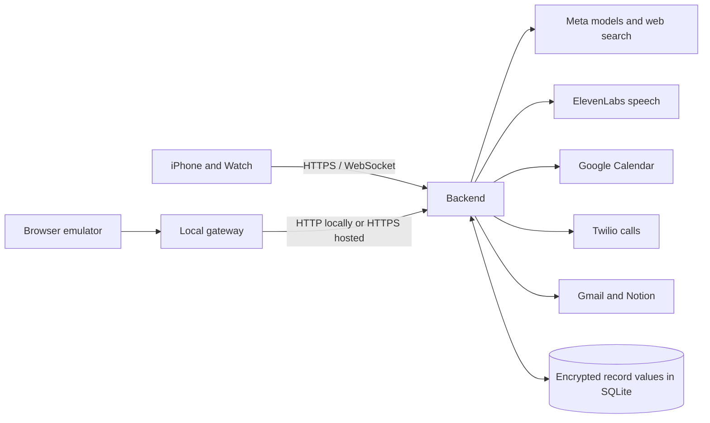

# Current architecture

Updated: 28 October 2026. This describes implemented code. Product aspirations and historical alternatives belong in [the roadmap](roadmap.md) and [original brief](sources/original-project-brief.md).

## Runtime and boundaries

Muse for Watch has native SwiftUI iPhone/Watch clients, a browser emulator and a TypeScript/Fastify backend. The private deployment uses one Fly.io Machine in London and one persistent SQLite volume. It is a single-user prototype, not a multi-tenant service.

Only the backend holds model, voice and OAuth secrets. Native connection credentials live in Keychain and sync using WatchConnectivity. The browser gateway adds the app token server-side. This bearer token protects the private API; public release still requires per-user identity and data ownership.

## Module map

| Source | Responsibility |
| --- | --- |
| [`app.ts`](../backend/src/app.ts) | Routes, authentication, validation, streaming responses and callback entry points |
| [`domain.ts`](../backend/src/domain.ts) | Validated plans, public types and provider interfaces |
| [`service.ts`](../backend/src/service.ts) | Sessions, personal memory, turn orchestration and Calendar action decisions |
| [`meta.ts`](../backend/src/meta.ts), [`search.ts`](../backend/src/search.ts) | Model planning, transcription and grounded answers with source links |
| [`realtime.ts`](../backend/src/realtime.ts), [`speech.ts`](../backend/src/speech.ts) | Live transcription relay and ElevenLabs synthesis |
| [`calendar.ts`](../backend/src/calendar.ts) | Google OAuth, account identity, availability, reads and event creation |
| [`connections.ts`](../backend/src/connections.ts), [`workflows.ts`](../backend/src/workflows.ts) | Gmail/Notion authorization and reviewed document workflows |
| [`calls.ts`](../backend/src/calls.ts) | Booking preparation, approvals, Twilio callbacks, negotiation and outcome verification |
| [`store.ts`](../backend/src/store.ts) | AES-256-GCM record-value encryption and SQLite transactions |

The domain modules stay separate from HTTP transport. Calling is still a single-process state machine; it is not a distributed job system. Moving to multiple Machines requires a shared storage/coordination design, not simply scaling the replica count.

## Conversation lifecycle

1. Tap starts recording. Audio streams through the backend to Meta transcription.
2. The client submits final text after speech ends. Partial transcripts never execute tasks.
3. The planner receives recent context and the current authoritative memory list.
4. A conversational answer streams toward speech playback; an action plan goes through schema validation and the relevant domain service.
5. Clients animate speech on actual playback and support interruption/cancellation. Emotions settle back to idle.

See [streaming replies](streaming-replies.md), [realtime transcription](realtime-transcription.md) and the [native guide](../native/README.md) for platform-specific behavior.

## External actions

**Calendar:** a proposal stores the event and expiry. A separate decision endpoint confirms or cancels it. Stable event identifiers and receipt checks allow uncertain-save recovery without blind duplication. Account identity must remain consistent across token refresh, requests and recovery.

**Booking calls:** a proposal contains the destination, customer, purpose, duration and allowed windows. Calendar conflicts remove candidates. Approval rechecks availability; it never broadens the approved set. Twilio receives a call only after the durable decision. Signed callbacks drive a bounded Meta/ElevenLabs conversation. The model sees approved booking details and permitted times, not unrelated memories or Calendar event contents. Internal candidate slots stay on the server; clients receive the allowed windows and eventual booked slot, with an empty legacy `slots` field for decoding compatibility.

A provider's “call completed” status is not proof of a booking. The outcome validator requires explicit matching confirmation. Calendar saving is a second, separately approved action. Ambiguous call creation is never automatically redialled.

**Notion:** generated content is reviewed before saving. Gmail access is read-only. Account setup for these connectors is currently paused; implemented code is not proof of a connected account.

## Persistence and privacy

SQLite stores records by kind and ID, with JSON values encrypted using AES-256-GCM. Identifiers are not encrypted. The encryption key is supplied outside Git; losing it makes existing encrypted values unreadable.

Stored records include conversation history, personal memories, provider grants, pending actions and receipts. Shared memories outlive individual sessions until edited/deleted. Session deletion does not undo external changes. Active or unresolved calls block deletion so recovery controls are not silently discarded.

Microphone audio is not persisted. Generated telephone reply clips are encrypted, accessible through opaque six-minute links, and pruned on later synthesis or restart. Expiry prevents retrieval; it is not an immediate physical-erasure guarantee. Provider retention is separate.

## Verification and limits

Automated tests use mocked provider responses to exercise failures, auth, cancellation, approvals, account races and recovery. They do not prove real speech quality or live booking success. Native host tests cover models and lifecycle; SDK builds check platform compilation; physical-device behavior requires separate acceptance testing.

Use [the verification record](backend-verification.md) for dated results and [private deployment](private-deployment.md) for operating instructions. The remaining product gate is a successful end-to-end live booking followed by an approved Calendar save.
