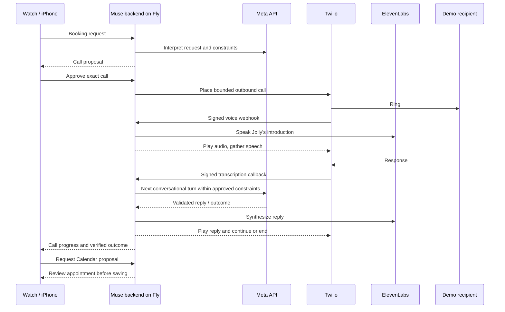

# Booking calls — Jolly speaks on your behalf

Decision: 27 October 2026. The hackathon demo now prioritizes **memory + Calendar + one booking call**, rather than adding more generic connectors. Gmail and Notion code remains available, but account setup is paused.

## Intended demo

“Jolly, call my barber and book a haircut tomorrow afternoon when I’m free.”

1. Resolve the business, exact international phone number, booking name, duration and allowed time window. Ask for missing details; never invent a phone number. Saved memories may provide user-supplied preferences.
2. Check Calendar when connected. Show whether availability was actually checked.
3. Present the destination, number and booking instructions for explicit approval.
4. Call the approved number. Introduce Jolly as an AI assistant calling on the user's behalf. Negotiate only within the approved scope and available time slots.
5. Report the actual outcome. A completed phone connection alone is not evidence of a booking.
6. If an appointment was explicitly confirmed, offer a Calendar proposal. A separate confirmation saves it.

The first live test must use a consenting demo participant. No calls to unrelated businesses are part of automated tests. No automatic dialling from a spoken “yes”, no payments, no call recording and no automatic redial after an ambiguous provider result.

## Architecture

Meta remains the reasoning provider using the existing Meta account and credits. ElevenLabs synthesizes Jolly's voice; it does not supply another agent brain. Twilio handles the telephone connection and speech recognition. Twilio and ElevenLabs usage is separate from Meta credits.

This initial implementation uses turn-based Twilio Gather, not a full-duplex audio bridge. It adds transcription, Meta and voice-generation latency per turn. Test that latency on a real call before describing the conversation as seamless. Asynchronous generation and short TwiML polling avoid holding a webhook open while generation runs; they do not eliminate model latency.

## Configuration

| Variable | Purpose |
| --- | --- |
| `TWILIO_ACCOUNT_SID` | Account owning the caller number |
| `TWILIO_AUTH_TOKEN` | Server-only API authentication and webhook validation secret |
| `TWILIO_FROM_NUMBER` | Voice-capable Twilio number in E.164 format |
| `TWILIO_ALLOWED_NUMBERS` | Comma-separated consenting demo destinations in E.164 format; empty blocks dialing |
| `CALLS_PUBLIC_URL` | `https://muse-for-watch-vlad.fly.dev` for the hosted service |

Existing Meta and ElevenLabs credentials remain required. These settings do not buy a phone number or place a call. Never put an app bearer token in a Twilio callback URL.

## Account setup and live acceptance

Twilio credentials and a voice-capable caller number are required. Trial-account destination verification and account geographic permissions may restrict where calls can go. Check the actual account and number price before purchasing. Keep credentials only in ignored private environment files and Fly secrets, never in the apps or Git.

The public callback origin must be the deployed HTTPS backend, not localhost. Calendar OAuth configuration and consent are independent of Twilio setup. The app must describe Calendar as unchecked while disconnected.

Before the demo, exercise:

- Approve and cancel proposals; verify cancelling never dials.
- Answer on a consenting test phone; verify the AI introduction and correct Jolly voice.
- Offer a valid time, an unavailable time, and a time outside the approved window.
- Decline the booking, stay silent, hang up, and leave the phone unanswered.
- Stop a running call from the app.
- Verify a successful booking result against what the recipient actually said.
- Review, approve and verify the corresponding Calendar event.
- Retry a client request after a simulated network failure and confirm it does not place another call.
- Confirm Apple Watch operation without the Mac, including background/resume behaviour.

## Primary references

- [Twilio outbound call resource](https://www.twilio.com/docs/voice/api/call-resource)
- [Twilio Gather speech input](https://www.twilio.com/docs/voice/twiml/gather)
- [Twilio webhook request validation](https://www.twilio.com/docs/usage/security)
- [ElevenLabs text-to-speech](https://elevenlabs.io/docs/api-reference/text-to-speech/convert)

Implementation and automated test results are recorded below once verified. A passing test suite is not evidence of a live telephone booking.

## Implementation and verification — 27 October 2026

Backend and native/browser review controls are implemented. Calls have a ten-minute approval expiry, five-minute duration cap, twelve-turn cap and bounded asynchronous generation. The client can stop an active call. Calendar candidates use fifteen-minute increments across every approved period, with an availability recheck before dialing when connected. An optional `booking.windows` array holds 1–14 nonoverlapping allowed periods inside the required `booking.window` envelope (at most 31 days). Window-only requests remain supported. Exclusions and gaps are preserved: the envelope is used to query Calendar, never to authorize a time outside the allowed periods. Proposals with more than 1,000 available candidates are explicitly rejected with a request to narrow the allowed days or hours; candidates are never silently truncated or later days starved.

A booked outcome needs an explicit positive recipient confirmation quoting the matching appointment day/month and numeric local start time. Ambiguous or incomplete confirmation prompts a clarification. This conservative English confirmation check may need repetition after transcription; test natural wording before the demo.

Automated provider fixtures exercise the full signed webhook flow and recovery paths. Four real Meta-only requests verified intent planning, allowed-slot responses and confirmed outcomes with synthetic booking data. The synthetic tests do not verify a live telephone call or Calendar write. Real audio latency, trial restrictions and device delivery remain acceptance checks.

The backend is deployed on Fly with the approved Twilio account, existing voice number and one consenting demo destination. Live status reports calling configured; a read-only Twilio check verified an active trial account and a voice-capable caller number. Unsigned public callbacks return 403. The other two verified caller IDs were removed at the owner's explicit request. One explicitly approved test call was subsequently placed to the selected demo phone; see the live result below.

Verification: 83 backend tests, 41 browser tests, 18 native host tests and native SDK builds passed. Review findings were fixed and independently re-reviewed. Native installation remains deferred at the owner's request; the previously installed app does not include these new call controls.

### First live test

The user approved one test call to their verified demo phone. Twilio connected and completed a 93-second call. Jolly disclosed its AI identity and handled two recipient replies with real Meta and ElevenLabs; the third reply failed. The backend correctly did not report a confirmed booking or write a Calendar event, but its generic failure text incorrectly called every generation failure a timeout. The original exception was not retained, so its provider/stage could not be established. An exact-history Meta replay returned valid JSON; it did not reproduce the original failure.

The repair adds safe stage/category/timing diagnostics, speaks concise natural start-time ranges, handles ordinal spoken dates and clarifies uncertain customer names. Malformed or truncated Meta responses get one bounded model-only retry; this never redials a telephone call. A replay with the failed transcript returned a concise clarification successfully. This does not establish the original failure cause or replace a live call test. Do not call this a successful end-to-end booking until a later live test completes.

Google Calendar OAuth is now connected on Fly. A real availability query succeeded without proposing or writing an event. The browser preview can target this deployed backend using `EMULATOR_BACKEND_URL`; see [preview setup](../preview/emulator/README.md). The native apps still need the new build installed.

The reviewed repair was deployed to Fly on 27 October 2026. Post-deployment checks passed: health 200, anonymous status 401, authenticated status 200 with calling configured, and unsigned Twilio callback 403. A second live call still requires the owner’s readiness and approval; the initial authorization covered one call only.

### Flexible bookings and saved preferences

The planner resolves business, phone, booking name, duration and time preferences from the authoritative saved-memory list. Current instructions override saved preferences; missing or ambiguous details still require clarification. Saved preferences never substitute for explicit call intent or approval.

On the call Jolly leads with a dated 12-hour range, such as “between 2 pm and 4:30 pm on 5 November”. These are permitted **start times**, after subtracting Calendar conflicts and allowing for the appointment duration. Separate days and busy gaps stay separate; internal fifteen-minute candidates are never read aloud. A deterministic offer guard replaces numeric or spoken time enumerations with one safe range. Once the recipient chooses a time, confirmation remains specific. Consent, payment refusal and strict positive booking evidence checks remain in force.

Validated on 28 October 2026: 89 backend tests, 42 browser tests, 19 native host tests and native SDK builds passed. Independent review caught and verified a fix for short-appointment gaps. A live Meta planner check with synthetic preferences correctly selected Monday, Tuesday, Wednesday and Friday afternoon windows, excluded Thursday, and used the current time preference over the saved one. This did not dial a number or write a Calendar event.

Flexible-booking backend deployed to Fly on 28 October 2026; health and authenticated status passed, anonymous status remained blocked, Calendar connected and calling configured. Updated native approval UI is built but not installed. Live booking acceptance remains pending.

Final call-style polish: brief AI introduction and consent question; 10–25-word replies as a model target, no repeated introductions or Calendar narration, accept suitable suggestions and clarify only missing confirmation. A Calendar connected between proposal and approval is checked before dialing; it can only narrow the approved times. Build and 90 automated backend tests passed. A real Meta check with synthetic booking data and mocked telephony/audio returned a 16-word range reply and a 15-word specific-time confirmation question. No phone call or Calendar write was performed. Live end-to-end acceptance is still pending.

Final polish deployed on 28 October 2026. Health/authenticated status passed with Calendar connected and calling configured.
