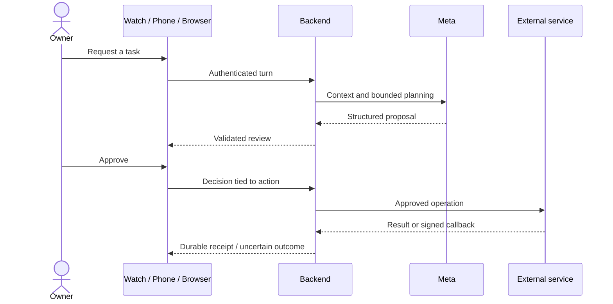

# Code map

Reviewed 29 October 2026. Entry points and ownership, not a replacement for source-level API schemas.

## Backend

| Area | Files in `backend/src/` | Responsibility |
| --- | --- | --- |
| Boot/config | `server.ts`, `config.ts`, `app.ts` | Configuration, dependencies, HTTP routes, authentication and errors |
| Conversation | `service.ts`, `meta.ts`, `realtime.ts`, `speech.ts` | Turn lifecycle, model planning, transcription and speech |
| Booking | `calls.ts`, `booking-profile.ts` | Approved dialing, signed callbacks, outcomes, retries and usual haircut preferences |
| Calendar | `calendar.ts` | OAuth, availability and event operations |
| Daily support | `briefing.ts`, `reminders.ts`, `gmail-drafts.ts` | Briefing assembly, reminder state and reviewed unsent drafts |
| Documents | `connections.ts`, `workflows.ts` | Gmail/Notion OAuth, bounded mail reads, destination selection and approved documents |
| Social/search | `social.ts`, `social-workflow.ts`, `search.ts` | Read/suggest social workflows and search-backed answers |
| Device access | `pairing.ts`, `notifications.ts` | Expiring pairing, revocable device tokens and APNs delivery |
| Persistence | `store.ts`, `maintenance.ts` | Encrypted record values, backup/restore and limited retention |

`app.ts` is the route inventory. Input/output definitions and action state are validated in the corresponding feature modules; inspect those before changing client contracts. `backend/test/` contains synthetic-provider regressions. `backend/scripts/` contains setup, smoke, pairing, maintenance, gateway and staging tools.

## Clients

- `native/MochiCore/`: shared Codable models, HTTP client, WAV and conversation rules. Package tests run without device installation.
- `native/Shared/`: conversation model, audio, realtime transcription, Keychain connection storage, WatchConnectivity, character renderer, action review and notifications.
- `native/iPhone/`: onboarding/pairing, connections, memories and task management.
- `native/Watch/`: wrist UI, approvals and task progress.
- `preview/emulator/`: browser voice lifecycle, streaming, tasks, booking/daily support and connector views. Its local Node gateway lives in `backend/scripts/emulator-server.mjs`.
- `preview/animation/`: character state playground and scripted checks. Design fixtures are not live results.
- `website/dist/`: static public introduction. `website/scripts/sync-agent.mjs` embeds `agent.md`; backend staging invokes that synchronization before copying allowlisted assets.

## Action lifecycle

A successful HTTP response is not always proof of an external write. Preserve uncertain outcomes and reconcile them. Booking confirmation is separate from Calendar approval; do not collapse those state machines.

## Deployment boundaries

The static website and the private backend are separate Fly apps. Only the backend mounts the SQLite volume and receives provider secrets. The backend also serves an allowlisted copy of the public website. There must be one writable backend machine; shared device access is not tenant isolation.
